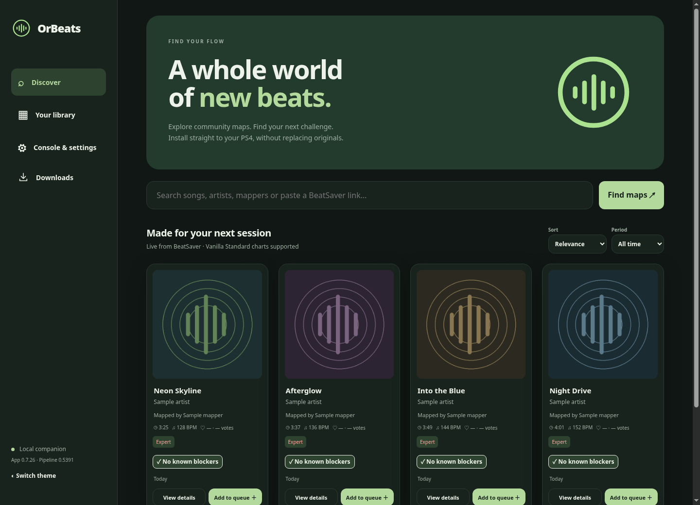
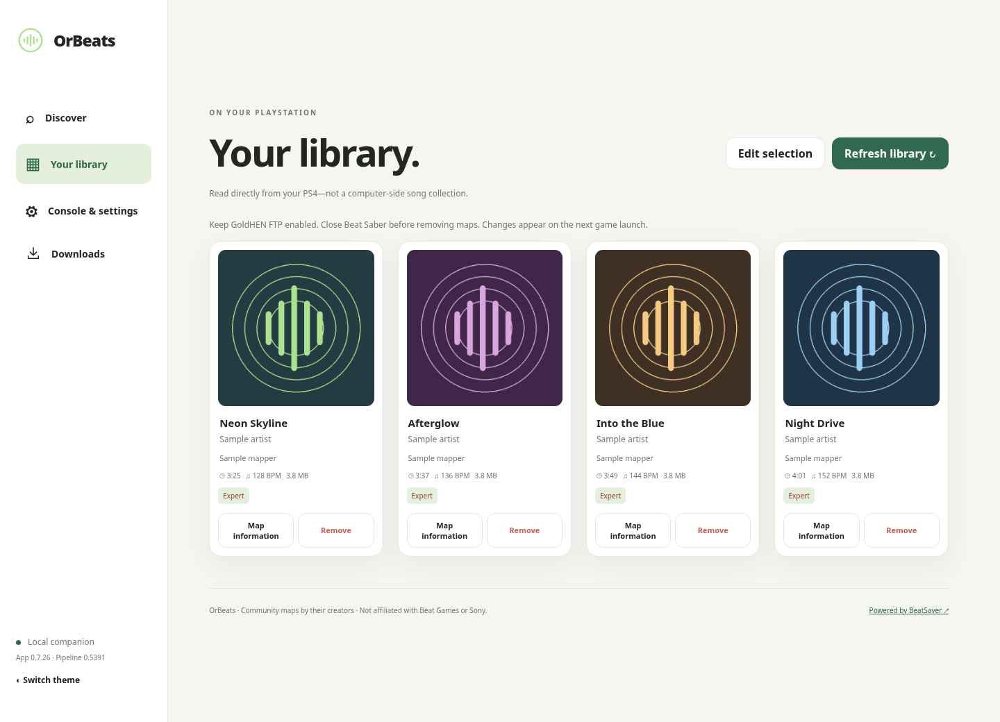

# OrBeats

**Custom songs for Beat Saber on PS4.**

Browse BeatSaver, build your library, and play without replacing the original soundtrack or DLC.

[Downloads](https://github.com/Wkrotik/OrBeats/releases/latest) · [Installation](docs/getting-started.md) · [Map support](docs/native-map-expansion.md) · [Development](docs/development.md)

## Your next session, made simple

- **Discover maps** with BeatSaver search, previews, filters and difficulty details.
- **Install from your computer** with a Windows or Linux companion—no rebuilding the plugin for each song.
- **Manage your library** with queued imports, installation logs and individual or bulk removal.
- **Keep the originals**: custom songs live in their own **OrBeats** pack alongside stock songs and DLC.
- **Add optional Extras** for health-warning auto-dismiss and a read-only top-ten
  ScoreSaber leaderboard on supported custom maps.
- **Check for updates** to the companion and both plugins from the official repository.
- **Make it yours** with light and dark themes.

<table>
<tr>
<td width="50%"> Discover · dark theme</td>
<td width="50%"> Your library · light theme</td>
</tr>
</table>

Screenshots show the companion with illustrative sample maps, not an active console session.

## Get started

You need **Beat Saber CUSA12878, patch 2.04**, on a PS4 with **GoldHEN plugin support and FTP enabled**, plus a Windows x64 or Linux x64 computer. Other game builds are not supported.

1. Open the companion and enter your PS4's IP address in **Console & settings**.
2. Set up the plugin and conversion template using the [installation guide](docs/getting-started.md).
3. Find a map, add it to Downloads and start the queue.
4. Once installation finishes, launch Beat Saber and open the **OrBeats** pack.

**Fully close Beat Saber before installing, removing songs or updating plugins.** OrBeats checks that the title is closed before writing console files.

## Map support

OrBeats imports supported vanilla **V2, V3 and V4** maps, including supported arcs, chains and lighting. It preserves authored gameplay rather than silently dropping unsupported features.

The library supports **up to 64 custom songs**. Chroma, Noodle Extensions and custom environments are not supported. See the [compatibility guide](docs/native-map-expansion.md) for precise requirements and limits.

## Documentation

- [Installation and everyday use](docs/getting-started.md)
- [Map compatibility](docs/native-map-expansion.md)
- [Building and contributing](docs/development.md)
- [CLI, file formats and recovery](docs/additive-companion.md)
- [Desktop packaging](desktop/README.md)
- [Plugin changelog](orbeats/CHANGELOG-PLUGIN.md) · [Companion changelog](orbeats/webapp/CHANGELOG-WEBAPP.md)

## Credits and license

Developed by **Wkrotik**, building on [Beat Saber Deluxe by Chris Primeish and contributors](https://github.com/free5ty1e/BeatSaberPcCustomSongToPs4InstallConverter). OrBeats retains and modifies upstream code under [GPL-3.0](LICENSE).

Thanks to the GoldHEN, OpenOrbis, BeatSaver and UnityPy projects. OrBeats is not affiliated with Beat Games, Meta or Sony. Game files, music and DLC are not distributed; song creators retain the rights to their work.
